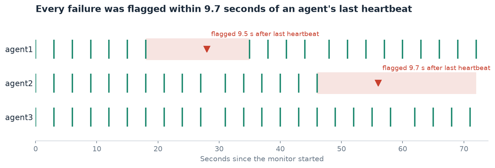

# serviceMonitor

A small network uptime monitor built on raw sockets. Agents register with a monitor over TCP, then send a UDP heartbeat every 3 seconds. If an agent goes quiet for 9 seconds, the monitor flags it DOWN and writes an alert to a persistent audit log. Everything runs as containers on an isolated Docker network, in Python's standard library only.

**[Interactive dashboard →](https://raajbanga.github.io/serviceMonitor/)** Replay a recorded run, or open your own audit log.



## How it works

| Step | Transport | Message |
|---|---|---|
| Agent registers on startup (retries with backoff until the monitor is up) | TCP `8001` | `REGISTER agent1` → `ACK` |
| Agent sends a heartbeat every 3 s | UDP `8002` | `HB agent1` |
| Monitor's per-agent watcher thread sees 9 s of silence | | writes `[CRITICAL] Agent agent1 DOWN` |
| Heartbeats resume | UDP `8002` | agent marked active, new watcher started |

- **Monitor** (`monitor/server.py`): one TCP listener, one UDP listener, and a watcher thread per agent. All events go to `logs/audit_log.txt`, which is bind-mounted so it survives container restarts.
- **Agents** (`agent/client.py`): three identical containers that register once, then heartbeat until stopped.
- **Capture sidecar** (optional): a `tshark` container sharing the monitor's network namespace, for looking at the traffic in Wireshark.

Every audit line has the same plain-text shape:

```
2026-11-16T22:29:03+00:00 [CRITICAL] Agent agent1 DOWN (no heartbeat for 9.5s)
```

## Quick start

Requires Docker with Compose v2.

```bash
docker compose up -d --build
tail -F logs/audit_log.txt          # in a second terminal

docker compose stop agent1          # inject a fault: DOWN appears ~10 s later
docker compose start agent1         # recovery: heartbeats resume
docker compose stop monitor && docker compose down
```

The audit log stays at `logs/audit_log.txt` across `down`/`up` cycles; new runs append to it. To view a run, open the [dashboard](https://raajbanga.github.io/serviceMonitor/) and choose **Open an audit log**.

Settings are environment variables in `docker-compose.yml`: `HEARTBEAT_INTERVAL_SEC` (agents, default 3) and `HEARTBEAT_TIMEOUT_SEC` (monitor, default 9).

## Tests

The tests drive the real containers with no mocks. Each module starts its own stack and tears it down afterwards.

```bash
python3 -m venv .venv && .venv/bin/pip install -r requirements-dev.txt

.venv/bin/pytest tests/test_unit.py -v          # monitor alone, driven over TCP/UDP from the host
.venv/bin/pytest tests/test_integration.py -v   # full stack: happy path, fault injection, log persistence
.venv/bin/pytest tests/test_system.py -v        # boot, concurrency, detection latency, log format, multi-fault, restart
```

The system suite takes about two minutes. It checks, among other things, that a stopped agent is flagged within 12 seconds of its last heartbeat and that the remaining agents keep working when two of three are down.

## Packet capture

```bash
./run-capture.sh
open captures/heartbeats.pcapng     # Wireshark
```

This starts the stack with the capture sidecar, stops `agent1` partway through to record a heartbeat gap, and writes the capture filtered to `tcp port 8001 or udp port 8002`.

## Recording a run for the dashboard

```bash
bash scripts/record_demo.sh                      # scripted run, writes docs/sample-run.log and .js
.venv/bin/python scripts/plot_timeline.py        # redraws docs/timeline.png
```

## Layout

```
monitor/      server.py + Dockerfile
agent/        client.py + Dockerfile
tests/        unit, integration, and system tests against the live stack
scripts/      record_demo.sh, plot_timeline.py
docs/         dashboard (GitHub Pages), sample run, timeline image
logs/         audit log (bind-mounted)
captures/     packet captures (gitignored)
```
